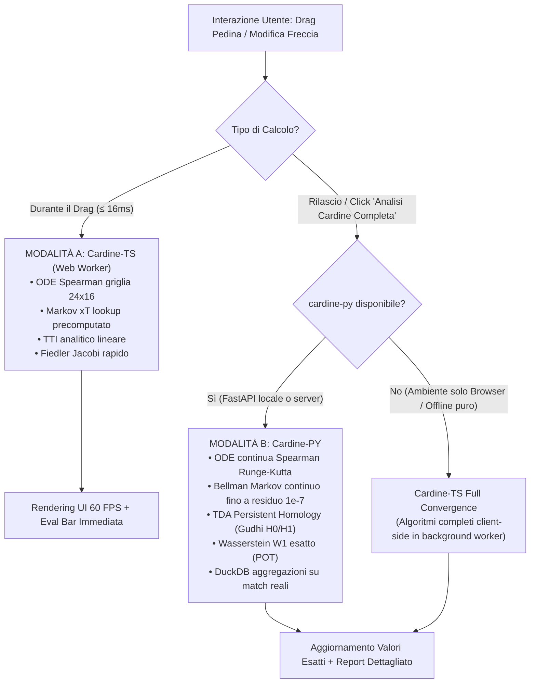

# BLUEPRINT ARCHITETTURALE: LAVAGNA TATTICA & MOTORE CARDINE
> **Versione:** 2.0.0 (Fusione Unitaria OpenPitch + OpenZone)  
> **Data:** 30 Ottobre 2026  
> **Proprietario & Autorità Matematica Suprema:** Marco Razzano (`0xOPENPITCH_MARCO_RAZZANO_FOUNDER_SUPREME_AUTHORITY`)  
> **Stato:** Proposta di Architettura & Specifica Esecutiva

---

## 1. Visione & Tassonomia Unificata

### 1.1 La Fusione in una Frase
**Lavagna Tattica** è la piattaforma unificata di intelligenza tattica calcistica aumentata (l'omologo di Chess.com per il calcio) alimentata dal motore **Cardine**, che unisce in un unico organismo la reattività interattiva client-side (6 Pilastri matematici a 60 FPS, 30 Tipologie Astratte, Human-in-the-Loop) con la profondità analitica server-side (data warehouse DuckDB, ingestione open data, TDA su simplessi complessi, ghosting generativo e standardizzazione multi-provider).

```
┌────────────────────────────────────────────────────────────────────────┐
│                          LAVAGNA TATTICA                               │
│                   (Prodotto Unificato & Monorepo)                      │
│                                                                        │
│   ┌────────────────────────────────────────────────────────────────┐   │
│   │   apps/studio  (Interfaccia Utente: React 19 + Vite + Tauri)   │   │
│   │                                                                │   │
│   │   • Lavagna (Canvas 2D/3D interattivo, Timeline 60 FPS)        │   │
│   │   • Video Lab (Omografia DLT 8x8, Calibrazione HITL)           │   │
│   │   • Benchmark (12 Dimensioni Tattiche & Match Reali)           │   │
│   │   • Didattica (Percorsi Guidati, Quiz, Puzzle 3 Passaggi)      │   │
│   │   • Dottrina (Catalogo 13 Maestri, Strategie, Spiegazioni)     │   │
│   │   • Governance (Registro ADR-Math di Marco Razzano)            │   │
│   └────────────────────────────────────────────────────────────────┘   │
│                                   │                                    │
│                     importa solo  ▼  contratti tipizzati               │
│   ┌────────────────────────────────────────────────────────────────┐   │
│   │                  packages/contracts                            │   │
│   │      (Zod Schemas, TypeScript Interfaces, OpenAPI 3.1)         │   │
│   └────────────────────────────────────────────────────────────────┘   │
│                   │                                 │                  │
│     chiama runtime│locale client      chiama runtime│remoto/locale py  │
│                   ▼                                 ▼                  │
│   ┌──────────────────────────────┐   ┌─────────────────────────────┐   │
│   │     packages/cardine-ts      │   │     packages/cardine-py     │   │
│   │  (Motore Client — Modo A)    │   │  (Motore Analitico — Modo B)│   │
│   │                              │   │                             │   │
│   │  • Spearman ODE Pitch Control│   │  • Ingestione Open Data     │   │
│   │  • Markov xT Bellman Solver  │   │  • Warehouse DuckDB locale  │   │
│   │  • Jacobi Fiedler λ₂ Solver  │   │  • Standardizzazione Kloppy │   │
│   │  • EKF Kalman Balistico      │   │  • TDA Simpliciale (Gudhi)  │   │
│   │  • Valutatore Chess.com      │   │  • Ghosting CVAE / Traiett. │   │
│   │  • 30 Archetipi & HITL       │   │  • Export Grafico Mplsoccer │   │
│   └──────────────────────────────┘   └─────────────────────────────┘   │
└────────────────────────────────────────────────────────────────────────┘
```

### 1.2 Regola di Nomenclatura Rigorosa
| Ambito | Nome Canonico | Ruolo / Spiegazione |
| :--- | :--- | :--- |
| **Prodotto Globale** | **Lavagna Tattica** | Nome commerciale, brand, titolo dell'applicazione desktop/web. |
| **Repository GitHub** | `lavagna-tattica` | Monorepo unificato GitHub. |
| **Motore Matematico** | **Cardine** | Il fulcro/asse su cui ruotano la fisica, lo spazio e la tattica del gioco. |
| **Pacchetto Motore TS** | `@cardine/client` (o `packages/cardine-ts`) | Libreria matematica autonoma TypeScript, zero-dependency server. |
| **Pacchetto Motore PY** | `cardine-py` (o `packages/cardine-py`) | Modulo analitico scientifico Python (FastAPI / CLI / DuckDB). |
| **Pacchetto Contratti** | `@cardine/contracts` | Schemi Zod, OpenAPI, tipologie condivise tra TS e Python. |
| **Canvas Principale** | **Lavagna** (`LavagnaScreen`) | La schermata operativa primaria con campo, pedine e timeline. |

---

## 2. Il Motore "Cardine" & I Due Regimi di Calcolo

Il principio non negoziabile di Marco Razzano è la **fluidità istantanea (60 FPS) su laptop modesti** unita al **rigore matematico senza scorciatoie**. Per conciliare entrambi i requisiti senza compromessi, Cardine adotta un'architettura a **Doppio Regime di Esecuzione**:



### 2.1 Tabella dei Regimi Matematici
| Componente Matematico | Modalità A (Interattivo / 60 FPS) | Modalità B (Analisi Profonda / Cardine-PY) |
| :--- | :--- | :--- |
| **Pitch Control (Spearman 2018)** | Griglia discretizzata 24×16, time-to-intercept analitico. | Integrazione numerica fine RK4, campi di velocità vettoriali con inerzia. |
| **Expected Threat (xT)** | Value iteration convergenza 1e-4 o lookup su matrice 16×24. | Matrice di transizione Markoviana continua 105×68 addestrata su open data. |
| **Resilienza Rete (Fiedler $\lambda_2$)** | Autovalori Jacobi su grafo delle 11 pedine (max 15 rotazioni). | Laplaciano pesato con conduttanza temporale e centralità spettrale. |
| **Topological Data Analysis (TDA)** | Filtrazione di Vietoris-Rips su 2-simplessi (proxy geometrico TS). | Persistent Homology $H_0, H_1$ completa con libreria `gudhi`. |
| **Ghosting Controfattuale** | Traiettorie quadratiche di Bézier orientate su gradienti xT. | Conditional Variational Autoencoder (CVAE) addestrato su tracking open data. |
| **Valutazione Chess.com** | Funzione di utilità $J = \Delta\text{xT} \cdot P_{\text{succ}} - \text{Risk}$, 3 alternative. | Ricerca ad albero Monte Carlo (MCTS) su sequenze multi-tocco. |

---

## 3. Struttura del Monorepo Unificato

```
lavagna-tattica/
├── apps/
│   └── studio/                         # UI Lavagna Tattica (React 19 + Vite + Tauri)
│       ├── src/
│       │   ├── screens/
│       │   │   ├── Lavagna/            # Canvas 2D/3D, pedine, frecce, timeline, xT
│       │   │   ├── VideoLab/           # Calibrazione 4 punti, HITL, omografia DLT
│       │   │   ├── Benchmark/          # 12 Dimensioni & test su partite storiche
│       │   │   ├── Governance/         # Registro ADR-Math Marco Razzano & Archetipi
│       │   │   ├── Educational/        # Percorsi guidati, quiz, puzzle terzo uomo
│       │   │   └── Community/          # Template tattici, libreria dottrinale
│       │   ├── components/
│       │   │   ├── canvas/             # Rendering SVG/Canvas 60 FPS
│       │   │   ├── studio/             # Toolbar, Timeline, selettori
│       │   │   └── ui/                 # Componenti design system
│       │   ├── stores/                 # Zustand (studio, viewport, selection, history)
│       │   ├── workers/                # Web Worker dedicato per calcoli Cardine-TS
│       │   ├── lib/                    # idb (IndexedDB offline), export
│       │   └── styles/                 # Temi (Verde Prato & Crema, Cyber Notte, Chalk)
│       ├── src-tauri/                  # Desktop wrapper Tauri v2
│       └── package.json
│
├── packages/
│   ├── contracts/                      # CONTRATTI UNIFICATI (Single Source of Truth)
│   │   ├── src/
│   │   │   ├── coordinates.ts          # Mappatura e conversioni canoniche
│   │   │   ├── tacticalState.ts        # Schema Zod TacticalState
│   │   │   ├── players.ts              # 30 Archetipi & Token pedine
│   │   │   ├── metrics.ts              # 6 Pilastri & Glossario
│   │   │   ├── events.ts               # Eventi, Tiri, Passaggi
│   │   │   └── index.ts
│   │   ├── openapi.yaml                # Specifica OpenAPI per Cardine-PY
│   │   └── package.json
│   │
│   ├── cardine-ts/                     # MOTORE MATEMATICO CLIENT-SIDE (TypeScript)
│   │   ├── src/
│   │   │   ├── math/
│   │   │   │   ├── homography.ts       # DLT 8x8 Gauss-Jordan & RANSAC
│   │   │   │   ├── pitchControl.ts     # Spearman ODE 2018 & TTI
│   │   │   │   ├── xtMarkov.ts         # Bellman Value Iteration
│   │   │   │   ├── fiedlerJacobi.ts    # Solver autovalori Laplaciano L=D-W
│   │   │   │   ├── kalmanEkf.ts        # Extended Kalman Filter 4x4
│   │   │   │   ├── wasserstein.ts      # Sliced W1 Optimal Transport
│   │   │   │   ├── nashEquilibrium.ts  # Minimax 2x2 analitico
│   │   │   │   └── chessEvaluation.ts  # Action Evaluator & Top-3 alternative
│   │   │   ├── hitl/
│   │   │   │   ├── calibration.ts      # 4 punti omografia campo-frame
│   │   │   │   └── whatIfEngine.ts     # Ricalcolo geometrico su spostamento
│   │   │   ├── cv/
│   │   │   │   └── rolePipeline.ts     # Pipeline 9 stadi (ByteTrack, CIELAB)
│   │   │   ├── presets/
│   │   │   │   ├── archetypes30.ts     # 30 Tipologie Astratte (Zero Nomi Propri)
│   │   │   │   ├── formations.ts       # 7 Moduli base (4-3-3, 3-5-2, ecc.)
│   │   │   │   └── doctrines.ts        # 13 Grandi Scuole & Maestri
│   │   │   └── worker/                 # Worker entrypoint per esecuzione parallela
│   │   ├── tests/                      # Suite test matematici unitari
│   │   └── package.json
│   │
│   ├── cardine-py/                     # MOTORE SCIENTIFICO SERVER-SIDE (Python)
│   │   ├── src/cardine/
│   │   │   ├── ingest/                 # Ingestione StatsBomb Open Data, DataHub PDDL
│   │   │   ├── standardize/            # Mapping canoni Kloppy & Opta
│   │   │   ├── warehouse/              # DuckDB engine locale embedded
│   │   │   ├── metrics/                # Socceraction (xG, xA, xT continuo, PPDA)
│   │   │   ├── spatial/                # Pass network weighted, pressing intensity
│   │   │   ├── tda/                    # Gudhi persistent homology H0/H1
│   │   │   ├── ghosting/               # Generatore traiettorie controfattuali CVAE
│   │   │   ├── glossary/               # Tassonomia YAML verificata e formule
│   │   │   └── api/                    # Server FastAPI (OpenAPI compliant)
│   │   ├── pyproject.toml
│   │   └── tests/
│   │
│   └── design-tokens/                  # Temi cromatici (Verde Prato, Notte Cyber, Gesso)
│
├── prompts/                            # Prompt AI per orchestrazione con guardrail
├── docs/
│   ├── BLUEPRINT.md                    # Questo documento
│   ├── ARCHITECTURE.md                 # Dettagli di flusso e bus dati
│   ├── METRICS.md                      # Trattazione matematica dei 6 Pilastri
│   ├── ADR-MATH/                       # Decisioni Matematiche firmate da Marco Razzano
│   │   ├── ADR-001-SPEARMAN-ODE.md
│   │   ├── ADR-002-MARKOV-BELLMAN-XT.md
│   │   ├── ADR-003-FIEDLER-JACOBI.md
│   │   └── ADR-004-CHESS-EVALUATION.md
│   ├── SOURCES.md                      # Licenze rigorose e open data policy
│   └── STATE.md                        # Registro onesto Real vs Proxy vs Stub
├── scripts/
│   └── audit_cardine.ts                # Audit matematico automatico a 8 test
├── package.json                        # Root pnpm-workspace
└── pnpm-workspace.yaml
```

---

## 4. Le 5 Migliorie Fondamentali Proposte

### Miglioria 1: Sistema di Coordinate Canonico a Centro Campo (SI Unit)
Finora coesistevano scala Opta $[0, 100]^2$, StatsBomb $[0, 120] \times [0, 80]$ e SVG $[1050 \times 680]$.  
**Proposta**: Nel pacchetto `@cardine/contracts`, lo standard interno canonico matematico è il sistema metrico FIFA centrato nel cerchio di centrocampo:
$$x \in [-52.5, +52.5]\text{ m}, \quad y \in [-34.0, +34.0]\text{ m}$$
* Il dischetto di centrocampo è $(0, 0)$.
* Le porte sono a $x = -52.5$ e $x = +52.5$.
* Tutte le formule fisiche (m/s, $a_{\max}$, TTI balistico, ODE di Spearman) operano direttamente in unità metriche reali senza costanti di riscalamento intermedie.
* Gli adapter convertono da/per Opta, StatsBomb e SVG solo alle interfacce perimetrali di I/O.

### Miglioria 2: Offloading su Web Worker Dedicato (`cardine-ts/worker`)
Per garantire le prestazioni su laptop modesti (Priorità #1 di Marco), l'esecuzione delle matrici ODE di Spearman (24×16) e delle value iteration di Bellman viene spostata su un Web Worker dedicato.
* La UI del canvas gira costantemente a 60 FPS senza micro-lag durante il dragging.
* Il Worker comunica tramite messaggi binari strutturati o Transferable Objects, aggiornando la Eval Bar e gli overlay in background con latenza $< 15\text{ ms}$.

### Miglioria 3: Registro di Trasparenza Metrica (Badge "Real vs Proxy")
Ogni dato mostrato nell'interfaccia deve recare l'indicazione visiva trasparente del motore di provenienza:
* `[CARDINE-TS · REALE]`: Calcolato con formulazione esatta client-side.
* `[CARDINE-TS · PROXY]`: Calcolato con approssimazione controllata (es. TDA 2-simplessi).
* `[CARDINE-PY · SCIENTIFICO]`: Calcolato dal backend scientifico con librerie Python complete.
Nessuna metrica simulata viene presentata come algoritmo completo. L'onestà intellettuale è incorporata nel codice.

### Miglioria 4: DuckDB WASM locale come Fallback del Data Warehouse
Se l'utente utilizza l'applicazione offline senza l'ambiente Python attivo, il modulo di warehouse sfrutta `duckdb-wasm` direttamente nel client per eseguire query SQL analitiche sui match open data (Serie A, campioni StatsBomb) senza richiedere alcun server locale attivo.

### Miglioria 5: Sigillo di Autorità Matematica nei Test di CI/CD
Lo script di audit `scripts/audit_cardine.ts` viene eseguito ad ogni commit e verifica:
1. Errore di riproiezione omografica DLT 8×8 $= 0.0\text{ m}$.
2. Conservazione probabilistica di Spearman: $P_{\text{home}} + P_{\text{away}} = 1.0000$.
3. Convergenza monotona di Bellman xT con residuo $< 10^{-6}$.
4. Calcolo autovalori di Jacobi del Laplaciano con ortogonalità spettrale verificata.
5. Riduzione della traccia di covarianza $\text{Tr}(P)$ nel filtro di Kalman EKF.
6. Valutazione dinamica e non-hardcoded stile Chess.com su cambi di stato.
7. Presenza e integrità degli ADR-Math firmati da Marco Razzano per ogni formula attiva.

---

## 5. Mappatura Completa di Fusione dei Moduli

| Modulo Originale | Provenienza | Collocazione Unitaria in Lavagna Tattica | Stato Scientifico |
| :--- | :--- | :--- | :--- |
| **Omografia DLT 8×8 + RANSAC** | OpenPitch | `packages/cardine-ts/src/math/homography.ts` | **Reale** |
| **Pitch Control ODE (Spearman 2018)** | OpenPitch | `packages/cardine-ts/src/math/pitchControl.ts` | **Reale** |
| **Expected Threat Markov (Singh 2018)**| OpenPitch | `packages/cardine-ts/src/math/xtMarkov.ts` | **Reale** |
| **Resilienza Spettrale (Fiedler $\lambda_2$)**| OpenPitch | `packages/cardine-ts/src/math/fiedlerJacobi.ts` | **Reale** |
| **Kalman EKF Balistico 4×4** | OpenPitch | `packages/cardine-ts/src/math/kalmanEkf.ts` | **Reale** |
| **Chess.com Evaluation Engine** | OpenPitch | `packages/cardine-ts/src/math/chessEvaluation.ts` | **Reale** |
| **Human-in-the-Loop Frame Simulator** | OpenPitch | `packages/cardine-ts/src/hitl/` | **Reale** |
| **30 Tipologie Astratte di Giocatori** | OpenPitch | `packages/cardine-ts/src/presets/archetypes30.ts` | **Reale** |
| **Catalogo Dottrinale 13 Maestri** | OpenPitch | `packages/cardine-ts/src/presets/doctrines.ts` | **Reale** |
| **Pipeline CV a 9 Stadi** | OpenPitch | `packages/cardine-ts/src/cv/rolePipeline.ts` | **Reale** |
| **Canvas Tattico 2D & Timeline 60 FPS** | OpenPitch | `apps/studio/src/screens/Lavagna/` | **Reale** |
| **Tema Verde Prato & Bianco Crema** | OpenPitch | `packages/design-tokens/` & `apps/studio` | **Reale** |
| **Laboratorio Didattico, Quiz & Puzzle**| OpenPitch | `apps/studio/src/screens/Educational/` | **Reale** |
| **Glossario Metriche con Formule Esatte**| OpenPitch/Lavagna | `packages/contracts/src/metrics.ts` | **Reale** |
| **Prompt AI Versionati con Guardrail** | LavagnaTattica | `prompts/` | **Reale** |
| **Ingestione Open Data (StatsBomb, PDDL)**| OpenZone | `packages/cardine-py/src/cardine/ingest/` | Da strutturare |
| **Warehouse DuckDB** | OpenZone | `packages/cardine-py/src/cardine/warehouse/` | Da strutturare |
| **Standardizzazione Kloppy** | OpenZone | `packages/cardine-py/src/cardine/standardize/` | Da strutturare |
| **TDA Simpliciale (Gudhi H0/H1)** | OpenZone | `packages/cardine-py/src/cardine/tda/` | Da strutturare |
| **Ghosting CVAE Generativo** | OpenZone | `packages/cardine-py/src/cardine/ghosting/` | Da strutturare |
| **Server FastAPI** | OpenZone | `packages/cardine-py/src/cardine/api/` | Da strutturare |

---

## 6. Roadmap Operativa di Esecuzione

```
┌─────────────────────────────────────────────────────────────────────────────┐
│ FASE 0: Sanificazione & Contratti                                           │
│ • Setup pnpm-workspace monorepo (apps/studio, packages/contracts, cardine) │
│ • Definizione schemi Zod e coordinate canoniche [-52.5, 52.5]x[-34, 34]     │
└──────────────────────────────────────┬──────────────────────────────────────┘
                                       ▼
┌─────────────────────────────────────────────────────────────────────────────┐
│ FASE 1: Isolamento del Pacchetto @cardine/client (Cardine-TS)               │
│ • Spostamento del motore matematico puro (DLT, Spearman, Bellman, Jacobi)   │
│ • Creazione del Web Worker dedicato per i 60 FPS su laptop modesti          │
│ • Esecuzione audit automatico di verifica matematica                        │
└──────────────────────────────────────┬──────────────────────────────────────┘
                                       ▼
┌─────────────────────────────────────────────────────────────────────────────┐
│ FASE 2: Consolidamento UI Studio & Schermata Lavagna                        │
│ • Rifattorizzazione schermate apps/studio (Lavagna, VideoLab, Benchmark...) │
│ • Applicazione di default del tema Verde Prato & Bianco Crema d'autore      │
│ • Integrazione completa catalogo dottrinale 13 maestri e flashcard offline  │
└──────────────────────────────────────┬──────────────────────────────────────┘
                                       ▼
┌─────────────────────────────────────────────────────────────────────────────┐
│ FASE 3: Strutturazione Pacchetto Scientifico Cardine-PY                     │
│ • Modulo Python cardine con ingest open data, DuckDB e API FastAPI         │
│ • Implementazione client di fallback automatico (Modo A <-> Modo B)         │
└──────────────────────────────────────┬──────────────────────────────────────┘
                                       ▼
┌─────────────────────────────────────────────────────────────────────────────┐
│ FASE 4: Packaging Desktop Offline (Tauri v2)                                │
│ • Configurazione Tauri v2 per compilazione Windows/macOS/Linux               │
│ • Test di portabilità offline e verifica consumo CPU/RAM su laptop modesto  │
└─────────────────────────────────────────────────────────────────────────────┘
```

---

## 7. Dichiarazione di Conformità & Governance

Ogni avanzamento algoritmico o modifica ai pesi delle metriche, alle costanti di inerzia fisica o alle soglie di classificazione rimarrà subordinato alla preventiva validazione e firma formale di **Marco Razzano** tramite la procedura codificata degli ADR-Math.
